# Sơ đồ tổng quan MRM và ERD DBML

Tài liệu này gồm hai đoạn mã độc lập: Use Case PlantUML mô tả phạm vi phần mềm đang có; DBML mô tả lại năm bảng cốt lõi đã chọn trong báo cáo thiết kế cơ sở dữ liệu. Các chức năng đã bị loại khỏi phạm vi như email thật, báo cáo/kiểm kê Director và phê duyệt ủy quyền không được đưa vào sơ đồ.

## 1. Use Case tổng quan bằng PlantUML

```plantuml
@startuml
left to right direction
skinparam packageStyle rectangle
skinparam shadowing false
skinparam actorStyle awesome

actor "Reader\nBác sĩ" as Reader
actor "Archivist\nNhân viên lưu trữ" as Archivist
actor "Director\nGiám đốc" as Director
actor "Admin\nQuản trị hệ thống" as Admin

rectangle "Hệ thống quản lý hồ sơ bệnh án MRM" {
 usecase "Đăng nhập, đăng xuất\nvà đổi mật khẩu" as UC_Auth
 usecase "Xem và chỉnh sửa\nthông tin cá nhân" as UC_Profile
 usecase "Gửi đề nghị đổi\nvai trò hoặc khoa" as UC_StaffChange
 usecase "Duyệt hoặc từ chối\nđề nghị nhân sự" as UC_StaffDecision
 usecase "Áp dụng thay đổi\nnhân sự đã duyệt" as UC_StaffApply

 usecase "Tra cứu hồ sơ\nvà xem chi tiết theo quyền" as UC_Search
 usecase "Khai báo hồ sơ điện tử mới" as UC_ElectronicIntake
 usecase "Kiểm tra và duyệt\nhồ sơ khai báo" as UC_RecordReview
 usecase "Tiếp nhận hồ sơ giấy\nvà cập nhật metadata" as UC_PaperIntake
 usecase "Quản lý danh mục hồ sơ\nvà chính sách lưu" as UC_Catalogs
 usecase "Duyệt chính sách lưu" as UC_RetentionApproval
 usecase "Quản lý cấu trúc\nvị trí kho" as UC_StorageLocations

 usecase "Đăng ký mượn một hoặc nhiều\nhồ sơ giấy" as UC_Borrow
 usecase "Theo dõi, bổ sung\nhoặc hủy yêu cầu" as UC_TrackBorrow
 usecase "Kiểm tra yêu cầu mượn" as UC_ReviewBorrow
 usecase "Duyệt yêu cầu thường\nvà xếp lịch nhận" as UC_ArchivistApproval
 usecase "Duyệt nhóm yêu cầu\ncó hồ sơ tử vong" as UC_DirectorApproval
 usecase "Giao hồ sơ, nhận trả\nvà cập nhật vị trí" as UC_Circulation

 usecase "Kiểm kê kho" as UC_Inventory
 usecase "Xem báo cáo vận hành\nvà nhật ký được phép" as UC_Reports
 usecase "Quản lý tài khoản" as UC_Accounts
 usecase "Nhận và xử lý\nthông báo nội bộ" as UC_Notifications
}

Reader -> UC_Auth
Reader -> UC_Profile
Reader -> UC_StaffChange
Reader -> UC_Search
Reader -> UC_ElectronicIntake
Reader -> UC_Borrow
Reader -> UC_TrackBorrow
Reader -> UC_Notifications

Archivist -> UC_Auth
Archivist -> UC_Profile
Archivist -> UC_StaffChange
Archivist -> UC_Search
Archivist -> UC_PaperIntake
Archivist -> UC_Catalogs
Archivist -> UC_StorageLocations
Archivist -> UC_ReviewBorrow
Archivist -> UC_ArchivistApproval
Archivist -> UC_Circulation
Archivist -> UC_Inventory
Archivist -> UC_Reports
Archivist -> UC_Notifications

Director -> UC_Auth
Director -> UC_Profile
Director -> UC_Search
Director -> UC_RecordReview
Director -> UC_DirectorApproval
Director -> UC_StaffDecision
Director -> UC_RetentionApproval
Director -> UC_Notifications

Admin -> UC_Auth
Admin -> UC_Accounts
Admin -> UC_StaffApply
Admin -> UC_Reports
Admin -> UC_Notifications

UC_ElectronicIntake..> UC_RecordReview: gửi kiểm tra / xét duyệt
UC_ArchivistApproval..> UC_ReviewBorrow: <<extend>>\n[hồ sơ thường]
UC_DirectorApproval..> UC_ReviewBorrow: <<extend>>\n[có hồ sơ tử vong]

note bottom of UC_DirectorApproval
 Có ít nhất một hồ sơ tử vong thì cả nhóm đăng ký
 cần lý do và chuyển Director duyệt.
 Sau khi Director duyệt, Archivist xếp lịch nhận.
 Không có người duyệt ủy quyền.
end note

note bottom of UC_StaffDecision
 Nhân viên gửi đề nghị; Director duyệt/từ chối.
 Nếu được duyệt, Admin áp dụng thay đổi.
end note

note bottom of UC_Notifications
 Thông báo qua chuông trong ứng dụng;
 không gửi email thật.
end note

note bottom of UC_Reports
 Director không có báo cáo hoặc kiểm kê.
 Báo cáo hiện thuộc phạm vi Archivist/Admin.
end note

note bottom of UC_Auth
 Hệ thống giới hạn màn hình và dữ liệu theo một role
 trên mỗi tài khoản. Admin không xem metadata bệnh án.
end note
@enduml
```



## 2. ERD năm bảng cốt lõi bằng DBML

Đoạn DBML dưới đây có thể dán vào dbdiagram.io. Cú pháp dùng theo [tài liệu DBML chính thức](https://dbml.dbdiagram.io/docs/). Sơ đồ thể hiện năm bảng cốt lõi và các quan hệ giữa chúng. `roles`, `employees`, `departments`, `record_types`, `storage_locations`, `request_events` và `notifications` là bảng liên quan của schema đầy đủ nhưng được lược khỏi lát cắt này; các cột FK đến những bảng đó được giữ và chú thích, không tạo quan hệ giả trong sơ đồ năm bảng.

```dbml
// MRM overview schema: five central business tables.
// Supporting tables such as roles, employees, departments,
// record_types, storage_locations, request_events and notifications
// are intentionally not defined in this five-table view.
// medical_records below is intentionally simplified for readability;
// reading_requests below is simplified in the same way.
// Omitted columns remain present in the real PostgreSQL tables.

Table app_users {
 id uuid [pk, not null, default: `gen_random_uuid()`]
 username varchar(64) [not null, unique]
 password_hash text [not null, note: 'Password hash only; never store plaintext.']
 display_name varchar(200) [not null]
 role_id uuid [not null, note: 'FK to roles.id; roles is outside this five-table slice.']
 status varchar(20) [not null, default: 'ACTIVE', note: 'ACTIVE, LOCKED, DISABLED']
 email varchar(254)
 department_id uuid [note: 'FK to departments.id; supporting table omitted.']
 approval_secret_hash text [note: 'Second-factor secret hash for Director approval.']
 version bigint [not null, default: 0]
 must_change_password boolean [not null, default: true]
 deleted_at timestamptz [note: 'Soft-delete marker; retains historical references.']
 created_at timestamptz [not null, default: `CURRENT_TIMESTAMP`]

 indexes {
 (role_id)
 (department_id)
 }
}

Table medical_records {
 id uuid [pk, not null]
 record_code varchar(64) [not null, unique, note: 'Immutable display code.']
 archive_number varchar(64) [unique, note: 'Nullable for electronic-only records.']
 patient_code varchar(64)
 patient_name varchar(200) [not null]
 birth_year smallint
 sex varchar(10) [not null, note: 'MALE, FEMALE, UNKNOWN']
 department_id uuid [note: 'FK to departments.id; supporting table omitted.']
 record_type_id uuid [note: 'FK to record_types.id; supporting table omitted.']
 deceased boolean [not null, default: false]
 discharge_date date
 current_location_id uuid [note: 'FK to storage_locations.id; supporting table omitted.']
 has_paper_copy boolean [not null, default: true]
 has_electronic_copy boolean [not null, default: true]
 record_state varchar(16) [not null, note: 'DRAFT, STORED, PUBLISHED']
 physical_status varchar(20) [not null, note: 'NOT_STORED, IN_STORAGE, UNAVAILABLE, READING, NOT_APPLICABLE']
 note varchar()
 created_by uuid [not null, note: 'FK to app_users.id.']
 created_at timestamptz [not null, default: `CURRENT_TIMESTAMP`]

 indexes {
 (patient_code)
 (department_id, discharge_date)
 (current_location_id)
 }
}

Table reading_request_batches {
 id uuid [pk, not null]
 submit_token uuid [not null, unique]
 requester_id uuid [not null, note: 'FK to app_users.id.']
 purpose varchar() [not null]
 registered_on date [not null]
 created_at timestamptz [not null, default: `CURRENT_TIMESTAMP`]
 requires_director boolean [not null, default: true]

 indexes {
 (requester_id, created_at)
 (id, requires_director) [unique]
 }
}

Table reading_requests {
 id uuid [pk, not null]
 batch_id uuid
 record_id uuid [not null, note: 'FK to medical_records.id.']
 requester_id uuid [not null, note: 'FK to app_users.id.']
 purpose varchar() [not null]
 state varchar(20) [not null, note: 'Current status of this record request.']
 registered_on date [not null]
 pickup_deadline date [note: 'Generated as registered_on + 2 calendar days.']
 requires_director boolean [not null, default: true]
 reviewer_id uuid [note: 'FK to app_users.id.']
 approver_id uuid [note: 'FK to app_users.id.']
 confirmed_by uuid [note: 'FK to app_users.id.']
 created_at timestamptz [not null, default: `CURRENT_TIMESTAMP`]

 indexes {
 (requester_id, created_at)
 (batch_id, record_id) [unique]
 }
}

Table reading_sessions {
 id uuid [pk, not null, default: `gen_random_uuid()`]
 request_id uuid [not null, note: 'FK to reading_requests.id.']
 record_id uuid [not null, note: 'FK to medical_records.id.']
 reading_on date [not null]
 state varchar(16) [not null]
 handed_at timestamptz
 handed_by uuid [note: 'FK to app_users.id.']
 received_by uuid [note: 'FK to app_users.id.']
 returned_at timestamptz
 returned_by uuid [note: 'FK to app_users.id.']
 hand_condition varchar(1000)
 return_condition varchar(1000)
 return_location_id uuid [note: 'FK to storage_locations.id; supporting table omitted.']
 exception_note varchar()
 exception_at timestamptz

 indexes {
 (request_id, reading_on) [unique]
 (reading_on, state)
 (record_id, reading_on) [note: 'Production schema uses a partial unique index for holding states.']
 (record_id) [note: 'Production schema uses a partial unique index for one open READING session.']
 }
}

// Core relationships included in this ERD slice.
Ref: app_users.id < reading_request_batches.requester_id
Ref: reading_request_batches.(id, requires_director) < reading_requests.(batch_id, requires_director)
Ref: app_users.id < reading_requests.requester_id
Ref: app_users.id < reading_requests.reviewer_id
Ref: app_users.id < reading_requests.approver_id
Ref: app_users.id < reading_requests.confirmed_by
Ref: medical_records.id < reading_requests.record_id
Ref: app_users.id < medical_records.created_by
Ref: reading_requests.id < reading_sessions.request_id
Ref: medical_records.id < reading_sessions.record_id
Ref: app_users.id < reading_sessions.handed_by
Ref: app_users.id < reading_sessions.received_by
Ref: app_users.id < reading_sessions.returned_by

// medical_records and reading_requests are readable subsets, not complete
// column-for-column copies of the production tables.
// References to roles/departments/catalog/storage tables are documented
// as notes above because their target tables are outside this five-table slice.
```

## 3. Ghi chú khi sử dụng

- Đoạn PlantUML là sơ đồ tổng quan theo bốn role đang có. Nó không bao gồm các luồng bị loại hoặc hoãn như gửi email thật, Director xem báo cáo/kiểm kê, cơ quan ngoài và người được ủy quyền.
- DBML là lát cắt năm bảng, không phải DDL để chạy trực tiếp trên PostgreSQL. Các ràng buộc phức tạp như trigger ngày nhận, partial unique index và check liên bảng vẫn nằm trong Java migrations.
- Schema hiện lưu `birth_year`, không lưu ngày/tháng sinh của người bệnh.
- Mã Use Case mô tả luồng hiện hành; để đối chiếu từng FR và giới hạn cụ thể, xem báo cáo as-built.

