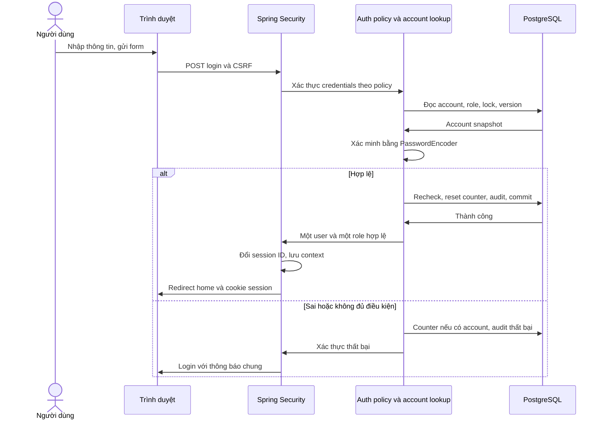

# Thiết kế đăng nhập — MRM-UC-01

> **Phạm vi lượt đầu đã thay đổi theo D-26:** xem [đăng nhập tối giản](basic-login-design.md). Hoãn quản lý phiên nâng cao, bắt buộc đổi mật khẩu lần đầu và quên/reset mật khẩu; session kỹ thuật cơ bản vẫn cần. Chi tiết mở rộng bên dưới không phải toàn bộ yêu cầu cho lượt đầu.

Phiên bản 0.1,. **Chỉ thiết kế, chưa code, chưa có bảng/migration hoặc kiểm thử được chạy.** D-24 (bốn role) và D-25 (mỗi user một role) đã được người dùng xác nhận. Ngưỡng bảo mật D-22, thuật toán/chi tiết vận hành bên dưới là phương án đề xuất để rà soát, không tự coi đã duyệt.

Đọc [use case](../../functions/mandatory/MRM-UC-01_authentication.md), [ma trận quyền](../../requirements/permission-matrix.md), [nhận xét biểu đồ](diagram-review.md) và [kế hoạch test](login-test-plan.md).

## 1. Mục tiêu và phạm vi lần đầu

Người có tài khoản nội bộ đăng nhập bằng username/password, nhận đúng quyền của một role, vào trang tương ứng, đăng xuất và được bảo vệ khi session hết hạn/khóa tài khoản/đổi quyền.

| Trong lát cắt đầu tiên | Chưa triển khai ở lát cắt này |
|---|---|
| Trang login, xác thực với PostgreSQL, một role/tài khoản, trang chào theo role | CRUD HSBA, yêu cầu/duyệt/giao–trả |
| Logout, session timeout, chống giả mạo, chặn sai role | Secret cấp 2 và proof dùng phê duyệt UC-10 |
| Giới hạn thử sai, audit auth tối thiểu, xử lý lỗi | Trang ADMIN quản lý/reset tài khoản đầy đủ UC-02 |
| Tài khoản mẫu phục vụ thử bằng quy trình khởi tạo an toàn | Tự đăng ký, quên mật khẩu qua email, OTP/SSO/JWT, remember-me |
| Kiểm thử đúng/sai, session, bốn role, khóa/đổi role | Tự đổi mật khẩu: thuộc phạm vi UC-01 rộng, thiết kế phụ riêng, làm sau login cơ sở |

Bốn trang chào ban đầu chỉ xác nhận tên/role và đường dẫn chức năng dự kiến, không cần xây toàn bộ dashboard nghiệp vụ. Không coi trang chào DIRECTOR là đã có chức năng duyệt.

## 2. Vai trò và dữ liệu đầu vào

- READER, ARCHIVIST, DIRECTOR, ADMIN dùng **cùng một form**.
- Không có dropdown chọn role, không gửi role trong form. Role do máy chủ đọc từ tài khoản; client sửa role không có tác dụng.
- Không có tài khoản công khai tự tạo. Chuẩn bị account mẫu riêng cho bốn role; không ghi password mặc định vào Git/README/log.
- Admin quản lý tài khoản theo UC-02; không tham gia xác thực từng lần người khác login.

| Trường | Quy tắc đề xuất | Phản hồi |
|---|---|---|
| username | Bắt buộc, 3–64 ký tự, chữ ASCII/số/dấu `.`, `_`, `-`; trim và lowercase nhất quán với lúc cấp account | Trống/sai định dạng: lỗi ngay tại trường |
| password | Bắt buộc; không trim, không lowercase; tối đa 128 ký tự đề xuất để giới hạn đầu vào | Không hiện lại giá trị hoặc đưa vào URL/log |
| csrf token | Do server phát, gắn session tiền xác thực; kiểm tra lúc POST | Sai/mất token: yêu cầu tải lại form, không tính là sai password |
| role/user_id/status | Không phải dữ liệu người dùng được gửi để quyết định quyền | Server tự đọc/kiểm tra |

D-22 đề xuất mật khẩu mới ít nhất 12 ký tự và chặn phổ biến; chính sách tạo/đổi password không được dùng để từ chối mật khẩu đã cấp hợp lệ chỉ vì form login tự áp một quy tắc khác. Chuẩn hóa username giống nhau khi lookup, unique và cấp tài khoản. Password giữ nguyên khoảng trắng/ký tự Unicode đã chọn; thuật toán hash/encode phải xử lý nhất quán.

## 3. Use case đăng nhập chi tiết (UC-01.A)

**Tác nhân:** người dùng nội bộ chưa xác thực. **Tiền điều kiện:** dịch vụ/DB hoạt động, account đã cấp một role hợp lệ. Có session tiền xác thực không có nghĩa đã đăng nhập. **Kích hoạt:** mở /login hoặc truy cập trang được bảo vệ khi chưa có session xác thực.

1. Server hiển thị form, CSRF token và nhãn trường; không yêu cầu chọn vai trò.
2. Người dùng nhập username/password và gửi một lần. UI có thể khóa nút khi đang xử lý, nhưng không dựa vào khóa nút để bảo vệ.
3. Server kiểm tra CSRF, kích thước/định dạng đầu vào và bộ giới hạn theo nguồn truy cập nếu có.
4. Chuẩn hóa username, tìm account; kiểm tra status, trạng thái tạm chặn login và role thuộc catalog bốn giá trị.
5. Xác minh password bằng PasswordEncoder. Account không tồn tại vẫn dùng đường xác minh giả phù hợp để giảm khác biệt thời gian; không ghi attempted password.
6. Thất bại hợp lệ về credentials: cập nhật counter khóa tạm nếu account tồn tại, ghi auth failure với lý do nội bộ, trả thông báo chung. Không tạo SecurityContext xác thực.
7. Thành công: trong giao dịch ngắn kiểm tra lại status/role/auth_version/lock để tránh thay đổi giữa xác minh và ghi; reset counter, cập nhật last_login_at và ghi audit thành công. Nếu snapshot đã thay đổi thì không cấp quyền cũ, yêu cầu đăng nhập lại.
8. Chỉ sau DB commit thành công mới tạo/lưu trạng thái xác thực; đổi session ID để chống session fixation. Session giữ user_id, role hiện tại, auth_version và thời điểm cần thiết, không giữ plaintext password/hash.
9. Điều hướng qua /home tới trang theo role. Phiên bản đầu luôn về trang role, không dùng returnUrl tùy ý hoặc tự phát lại POST cũ.
10. Nếu lỗi khi tạo session sau audit, xóa trạng thái xác thực tạm và ghi lỗi kỹ thuật cùng correlation. Audit credential success không tự chứng minh trang đã được tải; không đẩy người dùng vào session nửa vời.

**Hậu điều kiện thành công:** có session xác thực, role khớp DB, người dùng thấy đúng trang. **Thất bại:** không cấp phiên xác thực mới; có thông báo phù hợp, không lộ trạng thái account cụ thể.

## 4. Chính sách thử sai đề xuất — D-22 chưa duyệt

Phân biệt khóa quản trị và tạm chặn đăng nhập, không dùng cùng một cột để tự mở khóa tài khoản đã bị ADMIN khóa.

- `status`: ACTIVE / LOCKED (ADMIN khóa) / DISABLED; chỉ thao tác có quyền mới đổi.
- `failed_login_count`, `failure_window_started_at`, `login_blocked_until`: tạm chặn xác thực, không đổi status.
- Đề xuất: 5 lần password sai trong cửa sổ 15 phút → chặn login 15 phút kể từ lần thứ 5. Counter cập nhật nguyên tử; hai yêu cầu song song không làm mất lần đếm.
- Đã blocked: kể cả password đúng vẫn từ chối login; không gia hạn vô hạn lock mỗi lần thử trong khoảng đang block. Kết thúc khoảng block thì reset counter/window khi xử lý lần thử kế tiếp.
- Qua cửa sổ chưa đủ 5 sai: lần sai tiếp theo bắt đầu cửa sổ mới/count=1. Thành công trước ngưỡng reset count/window/blocked_until.
- Username không tồn tại: không tạo row APP_USER giả và không lưu vô hạn tên lạ. Giới hạn theo nguồn/endpoint bằng bộ đếm bounded có TTL là lớp bổ sung đề xuất, cùng thông báo chung; không tin IP header tùy ý từ client.
- Tạm chặn login do thử sai không tự vô hiệu các session đã xác thực, tránh người khác đoán password làm văng người đang dùng. ADMIN khóa/đổi role/reset password thì tăng auth_version để thu hồi session.

Thông báo chung cho sai password/không tồn tại/account khóa/block tạm: **“Không thể đăng nhập bằng thông tin đã cung cấp. Vui lòng kiểm tra hoặc liên hệ quản trị viên.”** Không trả riêng “username không tồn tại”, role hoặc thời gian khóa theo từng account.

## 5. Session, đăng xuất và truy cập

**Phương án đề xuất đơn giản:** HTTP session do ứng dụng giữ trong bộ nhớ một máy chủ; cookie chỉ giữ session ID. Chưa cần JWT, Redis, bảng session hoặc session cluster. Khởi động lại máy chủ làm mất session, người dùng đăng nhập lại.

| Tình huống | Hành vi cần thiết kế |
|---|---|
| Đăng nhập thành công | Đổi ID của session tiền xác thực; lưu security context đúng một role |
| Không hoạt động 30 phút (D-22) | Session hết hạn ở server; request tiếp theo về login, không tự gửi lại form cũ |
| Đăng xuất | POST có CSRF, xóa context và vô hiệu session hiện tại, xóa cookie phù hợp; về login thông báo đã đăng xuất |
| GET /logout | Không trực tiếp thay đổi trạng thái; nếu dùng thì chỉ trang xác nhận dẫn tới POST |
| Nhiều tab cùng cookie | Logout một tab làm session đó mất hiệu lực ở các tab còn lại tại request tiếp theo |
| Nhiều trình duyệt/session khác nhau | Đề xuất cho phép cùng login; logout chỉ session hiện tại. Đổi/reset password hoặc role/khóa account thu hồi toàn bộ session theo auth_version |
| Role/status đổi ở DB | Mỗi request bảo vệ đọc status/role/auth_version hiện tại; khác snapshot session thì xóa context, yêu cầu login lại |
| URL sai role | Đã đăng nhập nhưng không quyền → 403, không đổi role tự động hoặc thông báo password sai |
| DB không truy cập được khi kiểm tra quyền | Không cho qua bằng quyền cũ; trả lỗi dịch vụ trung tính, không lộ stacktrace |
| Nút Back sau logout | Có thể có bản hiển thị đã tải, nhưng request tiếp bị chặn; response bảo vệ dùng no-store để hạn chế cache |
| Cookie | HttpOnly, SameSite=Lax đề xuất; Secure trên HTTPS. HTTP localhost dev cần cấu hình riêng, không bật Secure rồi kết luận cookie lỗi |

Logout phải hoàn tất xóa session ngay cả nếu ghi audit DB thất bại: ghi lỗi/fallback kỹ thuật không chứa bí mật, không giữ người dùng đăng nhập vì logger lỗi. Đây là ngoại lệ an toàn so với quy tắc transaction nghiệp vụ chung. Sự kiện session hết hạn có thể do container/đến request kế tiếp, không hứa audit đúng giây hết hạn nếu không có cơ chế theo dõi chủ động.

## 6. Phác thảo giao diện trước khi code

```text
┌─────────────────────────────────────────────┐
│ MRM — Quản lý lưu trữ hồ sơ bệnh án │
│ Đăng nhập │
│ Tên đăng nhập │
│ [_______________________________________] │
│ Mật khẩu │
│ [***************************************] │
│ [Hiện/ẩn mật khẩu] │
│ │
│ [ Đăng nhập ] │
│ Không thể đăng nhập? Liên hệ quản trị viên. │
└─────────────────────────────────────────────┘
```

Không có chọn role/đăng ký/remember-me/khôi phục email ở đợt đầu. Trợ giúp “liên hệ quản trị viên” chỉ hướng dẫn quy trình ngoài, không gửi yêu cầu reset công khai vào DB. Có label, tab order, Enter submit, thông báo đọc được bằng screen reader và tiếng Việt đúng dấu. Tắt nút lặp khi pending, luôn kiểm tra server.

| Trạng thái UI | Nội dung |
|---|---|
| Trống/sai định dạng | Lỗi riêng trường, giữ username, password luôn rỗng sau phản hồi lỗi |
| Sai thông tin/khóa | Một thông báo chung, không hiển thị thông tin account |
| CSRF/session form hết hạn | “Phiên biểu mẫu không còn hợp lệ. Vui lòng tải lại và thử lại.” |
| Lỗi máy chủ/DB | “Tạm thời không thể đăng nhập. Vui lòng thử lại sau.” và correlation nếu cần |
| Session xác thực hết hạn | “Phiên làm việc đã kết thúc. Vui lòng đăng nhập lại.” |
| Logout thành công | “Bạn đã đăng xuất.” |
| Đã có session hợp lệ mở /login | Chuyển /home, không hiện form đăng nhập chồng lên session cũ |

Trang sau login: READER /reader/home; ARCHIVIST /archivist/home; DIRECTOR /director/home; ADMIN /admin/home. Đường dẫn là đề xuất hợp đồng, chưa có endpoint được viết.

## 7. Thiết kế dữ liệu tối thiểu

Không cần toàn bộ schema HSBA để login. Tối thiểu ROLE, APP_USER, AUTH_AUDIT_EVENT (hoặc phần auth của AUDIT_EVENT). ROLE_CHANGE_HISTORY cần khi UC-02 cho đổi role; chưa cần role_permission/access grant engine cho demo bốn trang.

| Trường APP_USER | Kiểu logic | Điều kiện |
|---|---|---|
| id | UUID PK | Do server tạo, bất biến |
| username | varchar(64) NOT NULL | Unique giá trị chuẩn hóa lowercase; validate lúc cấp account |
| password_hash | text NOT NULL | Hash có metadata thuật toán/chi phí; không plaintext hoặc mã hóa giải ngược |
| display_name | varchar(200) NOT NULL | Tên hiển thị |
| role_id | FK ROLE NOT NULL | Một giá trị; nhiều user được cùng role, không UNIQUE role_id |
| status | enum NOT NULL | ACTIVE/LOCKED/DISABLED |
| failed_login_count | integer NOT NULL | Mặc định 0, không âm |
| failure_window_started_at | timestamptz NULL | Bắt đầu cửa sổ sai |
| login_blocked_until | timestamptz NULL | Chặn login tạm, độc lập status |
| auth_version | bigint NOT NULL | Mặc định 0, tăng khi role/status/password đổi có yêu cầu thu hồi |
| must_change_password | boolean NOT NULL | Được dùng khi UC-02 reset; nếu true phải tới luồng đổi bắt buộc, không mở trang nghiệp vụ |
| last_login_at | timestamptz NULL | Giờ xác minh thành công đã commit; không coi là lịch sử mọi lần |
| created_at / updated_at / version | timestamp / timestamp / bigint | Dấu thời gian và kiểm soát sửa đồng thời |

ROLE có id/code/name, code chỉ bốn giá trị unique; không cho tạo role thứ năm qua UI. ROLE_CHANGE_HISTORY: id, user_id, old_role_id nullable lần cấp đầu, new_role_id, actor_id, reason/basis, occurred_at; chỉ thêm, không cấp quyền từ lịch sử.

Auth audit: id, actor_user_id nullable nếu chưa nhận diện, attempted_username đã chuẩn hóa/làm sạch và có chính sách lưu, action/outcome/reason_code, occurred_at server, correlation_id. Không password/hash, cookie ID, CSRF token hoặc secret cấp 2. Đầu vào dài lạ phải cắt giới hạn trước log. Failure do account không tồn tại phải có khả năng ghi khi không có user FK; nếu dùng chung AUDIT_EVENT, trường actor nullable hoặc system actor được đánh dấu rõ, không giả một tài khoản người dùng đã tồn tại.

Đề xuất dùng PasswordEncoder do Spring Security cung cấp với hash thích ứng (ví dụ PBKDF2 và định dạng có định danh thuật toán); tham số cụ thể được chọn/đo khi triển khai, không tự viết thuật toán hoặc ghim một hash cứng trong tài liệu. Cấu hình hash ở bước tạo tài khoản và xác minh login phải khớp. Session không chứa hash và không lưu DB trong thiết kế này.

**ERD lát cắt**

```mermaid
erDiagram
 ROLE ||-o{ APP_USER: current_role
 APP_USER o|-o{ AUTH_AUDIT_EVENT: identified_actor
 APP_USER ||-o{ ROLE_CHANGE_HISTORY: changes
 ROLE ||-o{ ROLE_CHANGE_HISTORY: new_role
```

Với slice đầu có thể chưa tạo ROLE_CHANGE_HISTORY khi chưa cho đổi role; khi thêm UC-02 bắt buộc lịch sử/audit. Không cần bảng DELEGATION hoặc USER_ROLE nhiều-nhiều.

## 8. Thiết kế backend và hợp đồng đường dẫn

Đây là phân công trách nhiệm, **không phải danh sách file đã tồn tại**.

| Thành phần dự kiến | Vai trò |
|---|---|
| SecurityFilterChain/Spring Security | Bảo vệ URL, form authentication, CSRF, session fixation, logout |
| LoginController | GET /login trả view; không tự viết lại POST so mật khẩu và đặt session bằng tay |
| UserDetailsService/repository | Lookup account chuẩn hóa và một role từ PostgreSQL |
| PasswordEncoder | Băm/xác minh đúng cấu hình |
| Auth policy service/handlers | Counter/lock, kiểm tra lại status/version, thông báo và điều hướng, audit |
| Current-account check | Mỗi request bảo vệ so status/role/auth_version, không dùng quyền cache sau khóa/reset |
| Home controller/view | Trang chào riêng theo role; chưa có dữ liệu nghiệp vụ |

Giữ package `mrm` đơn giản, chỉ tách khi có đủ lớp. Không tạo mô hình generic role-management phức tạp chỉ cho login; permission chi tiết triển khai cùng chức năng sau.

| Method/path đề xuất | Truy cập | Kết quả |
|---|---|---|
| GET /login và static cần thiết | Public | Form; đã xác thực về /home |
| POST /login | Chưa xác thực, CSRF hợp lệ | Spring Security xử lý credentials; success về /home, failure về login thông báo chung |
| GET /home | Có session hợp lệ | Điều hướng theo role DB/session đã kiểm tra |
| GET /reader/home | READER | Trang chào Reader |
| GET /archivist/home | ARCHIVIST | Trang chào Archivist |
| GET /director/home | DIRECTOR | Trang chào Director, chưa tự cấp proof phê duyệt |
| GET /admin/home | ADMIN | Trang chào Admin, không phải quyền HSBA |
| POST /logout | Session/CSRF hợp lệ | Vô hiệu session hiện tại, về /login?logout |

HTTP redirect của form sử dụng cơ chế framework (302/303 phù hợp); không bắt mọi request AJAX/API trả HTML trong các chức năng tương lai. Truy cập sai role trả 403; chưa xác thực về login; DB lỗi trả trang dịch vụ lỗi, không 403 giả. Saved POST không được replay. Password form không giữ trong model/flash sau failure.

## 9. Sơ đồ hoạt động và trình tự

```mermaid
flowchart TD
 A[Mở trang đăng nhập] -> B[Hiển thị form và CSRF]
 B -> C[Gửi username và password]
 C -> D{Form và CSRF hợp lệ?}
 D ->|Không| E[Lỗi biểu mẫu, không tăng counter password]
 D ->|Có| F{Account hoạt động, role hợp lệ, chưa block?}
 F ->|Không| G[Thông báo chung, không cấp session]
 F ->|Có| H{Password khớp?}
 H ->|Không| I[Counter nguyên tử, block nếu đủ ngưỡng, audit thất bại]
 I -> G
 H ->|Có| J[Recheck account, reset counter, audit và commit]
 J -> K{Lưu thành công?}
 K ->|Không| L[Lỗi dịch vụ, không cấp quyền]
 K ->|Có| M[Đổi session ID, lưu một role và auth_version]
 M -> N[Trang chào theo role]
```

Flowchart này là sơ đồ hoạt động giản lược, không phải UML use case. Với username không tồn tại vẫn có xử lý xác minh giả, không coi nhánh kiểm tra account là cho phép bỏ chống khác biệt thời gian.



## 10. Thiết kế kiểm thử và thứ tự code về sau

Xem [login-test-plan.md](login-test-plan.md), tất cả NOT RUN. Chưa cần chạy build hoặc kiểm thử cho thay đổi chỉ có tài liệu.

Sau khi người dùng duyệt thiết kế: chuẩn bị DB/secret → migration tối thiểu/seed bốn role và tài khoản thử an toàn → backend auth/session → login view/trang chào → test credentials/role/counter/session/khóa đồng thời → ghi kết quả. Không bắt đầu CRUD tài khoản/HSBA khi lát cắt auth cơ sở chưa ổn.

## 11. Điểm đang chờ rà soát

- D-22: idle 30 phút, ngưỡng 5/15/15 và chính sách password mới.
- Chấp nhận nhiều trình duyệt login đồng thời hay chỉ một; đề xuất cho nhiều để bớt cơ chế quản lý.
- Mức audit auth và phản ứng khi DB/audit lỗi; logout luôn phải xóa session.
- Thứ tự làm tự đổi password: khi must_change_password=true, cần có luồng đổi bắt buộc trước dùng account tạm; nếu chưa làm, tài khoản test phải được tạo ở trạng thái không yêu cầu đổi qua quy trình an toàn.
- Phần cấp 2 vẫn riêng D-10/UC-10, chỉ DIRECTOR, không phải trường bắt buộc của login.

## Nguồn kỹ thuật tham khảo

- [Spring Security Form Login](https://docs.spring.io/spring-security/reference/7.0/servlet/authentication/passwords/form.html): HTML form, filter xác thực, controller GET và success/failure.
- [Session management](https://docs.spring.io/spring-security/reference/7.0/servlet/authentication/session-management.html): context/session và bảo vệ fixation.
- [Logout](https://docs.spring.io/spring-security/reference/7.0/servlet/authentication/logout.html): làm sạch context/session và logout có CSRF.

Tham khảo hành vi nền tảng, không ghim phiên bản thư viện theo số hiển thị của website; dependency sẽ theo BOM của dự án khi triển khai.
