# Báo cáo đối chiếu yêu cầu và phần mềm đã xây dựng


**Phạm vi:** mã nguồn hiện tại của MRM và ba tài liệu DOCX được cung cấp.
**Mục đích:** phân biệt yêu cầu gốc, các quyết định thay đổi sau đó và chức năng đang có trong phần mềm; cung cấp mã Use Case PlantUML để tự render.

> **Kết luận ngắn:** phần mềm đã có một ứng dụng web học tập/pilot khá rộng cho quản lý metadata hồ sơ, yêu cầu mượn hồ sơ giấy, phê duyệt theo nhánh, lưu kho, giao–trả, thông báo nội bộ, tài khoản và báo cáo giới hạn. Tuy nhiên, không nên ghi nhận là đã đáp ứng toàn bộ SRS hoặc sẵn sàng vận hành bệnh viện. Email thật, HIS, yêu cầu cơ quan ngoài, ủy quyền, kiểm kê của Director, báo cáo Director và một số NFR vận hành/pháp lý đã bị hoãn, thu hẹp hoặc chưa có bằng chứng nghiệm thu.

## 1. Cách đọc báo cáo

- **SRS gốc** là `SRS_Quan_ly_luu_tru_HSBA_v0.2_da_lam_ro.docx`, phiên bản 0.2. Hai DOCX còn lại là nhận xét/đánh giá và đề xuất làm rõ; không tự xem các đề xuất đó là yêu cầu đã được bệnh viện phê duyệt.
- Trạng thái “đã có” dưới đây có nghĩa là đã tìm thấy luồng hoặc thành phần tương ứng trong mã nguồn hiện tại. Nó không đồng nghĩa mọi tiêu chí nghiệm thu, chính sách bệnh viện hoặc NFR đã được chứng nhận.
- Các quyết định được bạn xác nhận trong những trao đổi sau DOCX được xem là **thay đổi phạm vi sau SRS**. Bảng so sánh nêu cả điểm thay thế lẫn điều còn thiếu.
- Mã Use Case bên dưới mô tả hệ thống hiện tại, không phải mã UC gốc trong tài liệu DOCX.

## 2. Đối chiếu FR-01–FR-20

| FR | Yêu cầu trong SRS | Trạng thái trong phần mềm hiện tại | Thay đổi / giới hạn so với tài liệu |
|---|---|---|---|
| FR-01 | Đăng nhập, đăng xuất và truy cập theo quyền | **Đã có** | Bốn vai trò Reader, Archivist, Director, Admin; tài khoản một vai trò. Có đổi mật khẩu lần đầu theo yêu cầu bổ sung sau đó; Director thiết lập mật khẩu cấp 2. |
| FR-02 | Quản lý tài khoản và vai trò | **Đã có, có mở rộng** | Admin tạo tài khoản tự động, tìm theo tên/role/CCCD, sửa và xóa theo kiểu lưu trữ/vô hiệu hóa để giữ lịch sử; nhân viên đề nghị đổi role/khoa, Director duyệt/từ chối, Admin áp dụng. Không có email SMTP; thông báo luồng nhân sự là thông báo nội bộ theo quyết định sau. |
| FR-03 | Tra cứu HSBA | **Đã có** | Tra cứu thống nhất hồ sơ giấy và điện tử theo mã/tên/bộ lọc; nút mượn chỉ áp dụng cho hồ sơ có bản giấy và đủ điều kiện. Hồ sơ khai báo/chờ duyệt được phân khu riêng với hồ sơ chính thức. |
| FR-04 | Hiển thị dữ liệu theo vai trò | **Đã có ở mức ứng dụng** | Reader xem metadata được cấp, không xem vị trí kho chi tiết; Archivist xử lý lưu trữ; Director duyệt/giám sát theo route còn mở; Admin quản trị tài khoản và audit kỹ thuật, không truy cập dữ liệu bệnh án theo phân quyền hiện tại. Cần kiểm thử bảo mật độc lập trước triển khai thật. |
| FR-05 | Quản lý vị trí vật lý và lịch sử vị trí | **Đã có** | Archivist quản lý cây Kho–Kệ–Ngăn, sức chứa/trạng thái và thao tác di chuyển/cất lại có lưu lịch sử. Nhãn vị trí trên giao diện được Việt hóa. |
| FR-06 | Trạng thái hồ sơ, chống giao trùng, ngoại lệ | **Đã có một phần** | Trạng thái hồ sơ và phiên mượn được tách; có chặn một số thao tác xung đột/giao trùng. Biểu mẫu ngoại lệ trên giao diện Archivist đã được yêu cầu gỡ; endpoint/service xử lý ngoại lệ vẫn còn trong mã. Vì vậy không coi toàn bộ quy trình ngoại lệ là hoàn thiện qua UI. |
| FR-07 | Khởi tạo/cập nhật metadata, không nối HIS | **Đã có** | Dùng metadata; hồ sơ giấy và điện tử dùng chung bảng nghiệp vụ `medical_records`. Reader khai báo hồ sơ mới, Archivist khai báo hồ sơ giấy; có kiểm tra và trình duyệt. Không lưu bản quét/nội dung bệnh án. |
| FR-08 | Reader đăng ký ngày đọc, mỗi ngày là một phiên | **Đã có nhưng quy trình đã đổi** | Reader đăng ký một nhóm nhiều hồ sơ; ngày nhận do Archivist chọn trong giới hạn hai ngày lịch từ lúc đăng ký. Mỗi hồ sơ được theo dõi/duyệt riêng. Đây là khác với mô hình yêu cầu/ngày ban đầu trong SRS. |
| FR-09 | Archivist kiểm tra và trình Director/người được ủy quyền | **Đã có theo nhánh duyệt mới** | Archivist kiểm tra yêu cầu. Hồ sơ thường có thể do Archivist phê duyệt và xếp ngày/phòng; nếu nhóm mượn có hồ sơ tử vong thì cả nhóm chuyển Director. Không triển khai người được ủy quyền. |
| FR-10 | Phê duyệt điện tử, xác thực cấp 2, ghi người/lúc/lý do | **Đã có theo phạm vi điều chỉnh** | Director dùng mật khẩu cấp 2 khi quyết định các yêu cầu thuộc nhánh Director; lưu lịch sử quyết định. Các yêu cầu thông thường được Archivist quyết định. Ủy quyền bị hoãn; đây là thay đổi so với SRS. |
| FR-11 | Gửi email kết quả/lịch, mục tiêu tối đa 5 phút | **Được thay bằng thông báo nội bộ** | Chuông và inbox thông báo theo role/người nhận; có đọc/xóa thông báo đã xử lý. Không cấu hình SMTP, không gửi email thật và không đáp ứng/đo SLA email 5 phút. |
| FR-12 | Giao–trả tại phòng đọc, cập nhật trạng thái/vị trí | **Đã có** | Archivist ghi nhận giao, nhận trả, tình trạng hồ sơ và vị trí cất lại; dashboard phân biệt chờ nhận với đang mượn. |
| FR-13 | Lịch sử nghiệp vụ/audit, yêu cầu lưu 10 năm | **Có chức năng ghi/xem, thời hạn lưu chưa được chứng nhận** | Có nhật ký xác thực, quyết định, luồng hồ sơ, thao tác quản trị và báo cáo. UI không có chức năng sửa/xóa audit. Chính sách 10 năm chưa chứng minh bằng vận hành thực tế, backup hoặc chống sửa từ tài khoản DB đặc quyền. |
| FR-14 | Quản lý metadata tử vong; khai thác/duyệt ngoài ứng dụng theo SRS | **Đã thay đổi theo yêu cầu sau đó** | Metadata tử vong được lưu trong hồ sơ; có thể đăng ký mượn trong ứng dụng với lý do bắt buộc. Có hồ sơ tử vong thì cả nhóm yêu cầu phải được Director duyệt. Điều này **thay thế** chỉ dẫn ban đầu “xử lý ngoài phần mềm”. |
| FR-15 | Nhóm thời hạn 10/15/20/30 năm, không tiêu hủy | **Đã có ở mức mô phỏng** | Có danh mục/chính sách và tính mốc từ ngày đầu lưu, áp dụng thời hạn dài nhất khi có nhiều nhóm. Đây là cấu hình mô phỏng được người dùng chấp thuận cho dự án học tập, không phải xác nhận tuân thủ quy định pháp luật hiện hành. |
| FR-16 | Báo cáo và thống kê | **Có nhưng đã thu hẹp quyền** | Báo cáo/CSV/in có trong các route còn lại (Archivist và Admin trong phạm vi cho phép). Theo yêu cầu sau đó, báo cáo đã bị xóa khỏi Director và `/director/reports` bị chặn. Director không có báo cáo nghiệp vụ hiện tại. |
| FR-17 | Khởi tạo dữ liệu không HIS | **Đã có theo phương án nhập tay** | Không có tích hợp HIS. Dữ liệu được khai báo thủ công trong ứng dụng. Nhập tệp không được đưa vào phạm vi hiện tại. |
| FR-18 | Yêu cầu từ cơ quan bên ngoài | **Ngoài phạm vi** | Không có tài khoản hoặc workflow cho cơ quan ngoài, đúng với loại trừ trong SRS. |
| FR-19 | Kiểm kê/đối soát kho | **Có cho Archivist; Director đã bị loại khỏi chức năng** | Archivist có đợt kiểm kê và ghi kết quả. Theo yêu cầu sau đó, kiểm kê không hiển thị/cung cấp cho Director; route Director bị chặn. |
| FR-20 | Xuất báo cáo/dữ liệu theo quyền và lưu vết | **Đã có một phần** | Báo cáo hỗ trợ CSV và in qua trình duyệt, có ghi audit và giới hạn theo route/quyền. Không có dịch vụ tạo XLSX/PDF riêng; thao tác in trình duyệt không chứng minh người dùng đã lưu/nhận file PDF. |

### Những thay đổi nghiệp vụ đáng chú ý so với SRS

1. **Email → chuông thông báo nội bộ:** thay đổi đã được bạn yêu cầu rõ; FR-11 chỉ được xem là thay thế một phần, không phải gửi email.
2. **Duyệt mượn:** bỏ quyền người được Director ủy quyền; Archivist duyệt hồ sơ thường, Director duyệt toàn bộ nhóm nếu có hồ sơ tử vong.
3. **Hồ sơ tử vong:** thay luồng ngoài phần mềm bằng luồng đăng ký/duyệt trong ứng dụng; bắt buộc lý do và Director duyệt nhóm có hồ sơ tử vong.
4. **Một lượt đăng ký nhiều hồ sơ:** thay cấu trúc ban đầu; mỗi hồ sơ trong nhóm có quyết định/tiến trình riêng. Archivist đặt ngày nhận, tối đa hai ngày lịch tính từ ngày đăng ký.
5. **Hồ sơ giấy và điện tử:** dữ liệu đã hợp nhất vào `medical_records`, đánh dấu hình thức bản giấy/bản điện tử; không tạo nội dung số/bản quét bệnh án.
6. **Vai trò Director:** báo cáo và kiểm kê đã bị gỡ/chặn theo yêu cầu giao diện gần đây, dù tài liệu FR-16/19 ban đầu có đề xuất các phần tổng hợp cho Director.
7. **Ngoại lệ lưu trữ:** giao diện nhập ngoại lệ đã gỡ theo yêu cầu; mã backend còn tồn tại. Cần coi đây là chức năng chưa hoàn chỉnh về trải nghiệm/UI.

## 3. Yêu cầu phi chức năng (NFR)

SRS gốc có NFR-01–10. Các trạng thái dưới đây đánh giá khả năng hiện có của phần mềm, không tuyên bố đã đạt chứng nhận hoặc SLA.

| NFR | Mục tiêu SRS | Hiện trạng/đánh giá |
|---|---|---|
| NFR-01 Bảo mật và xác thực | Tài khoản nội bộ, RBAC, quyền duyệt giới hạn | **Đã có biện pháp nền tảng:** Spring Security, bốn role, kiểm soát route, hash mật khẩu, CSRF, kiểm tra lại trạng thái tài khoản. Chưa có đánh giá xâm nhập/bảo mật độc lập. Quyền duyệt thực tế đã đổi như FR-09/10. |
| NFR-02 Bảo mật dữ liệu nhạy cảm | Không lưu nội dung số; metadata theo quyền | **Đã có một phần:** hệ thống tập trung metadata, không lưu bản quét/toàn văn; phân quyền trường/dữ liệu ở các luồng chính. Chưa có rà soát bảo vệ dữ liệu cá nhân, cấu hình production và log/export toàn diện. |
| NFR-03 Nhật ký kiểm toán | Audit quan trọng, 10 năm, hạn chế xem/sửa/xóa | **Có audit và không có chức năng sửa/xóa qua UI. Chưa đạt/kiểm chứng thời hạn 10 năm và chống DBA/superuser sửa trực tiếp.** Cần backup/retention vận hành và phân quyền DB. |
| NFR-04 Hiệu năng | Tìm kiếm/chi tiết/báo cáo đáp ứng tải thực tế | **Chưa nghiệm thu.** Có bằng chứng hồi quy chức năng lịch sử trong `FR_COMPLETION_REPORT.md`, nhưng không có đo p95, tải đồng thời, cấu hình production hoặc ngưỡng đã được đơn vị phê duyệt. |
| NFR-05 Tính sẵn sàng | Giờ vận hành, bảo trì, xử lý gián đoạn | **Chưa triển khai/chưa xác định.** Chưa có SLA, giám sát, dự phòng hoặc quy trình vận hành được phê duyệt. |
| NFR-06 Sao lưu và khôi phục | Chính sách backup, restore, RPO/RTO | **Chưa có bằng chứng hoàn thành.** Không thấy báo cáo diễn tập restore/RPO/RTO được nghiệm thu; cần thiết lập ngoài code và kiểm chứng. |
| NFR-07 Khả dụng/dễ sử dụng | Tiếng Việt, thuật ngữ nghiệp vụ, lỗi rõ ràng | **Đã có một phần:** giao diện tiếng Việt và được tinh chỉnh theo phản hồi của bạn. Chưa có UAT chính thức/đo lỗi thao tác với bác sĩ và nhân viên tại đơn vị. |
| NFR-08 Toàn vẹn dữ liệu | Nhất quán duyệt, giao–trả, vị trí; chống cạnh tranh | **Có biện pháp trong code:** transaction, version/check, ràng buộc DB và logic chống một số thao tác trùng. Các bài kiểm tra lịch sử có kiểm tra chức năng; vẫn cần chạy lại bộ kiểm thử trên đúng revision hiện tại trước nghiệm thu cuối. |
| NFR-09 Tương thích/triển khai | Web nội bộ, không HIS giai đoạn thử nghiệm | **Đã có web Spring Boot và không nối HIS. Chưa chốt/kiểm thử ma trận trình duyệt, hệ điều hành, HTTPS và cấu hình server triển khai nội bộ.** |
| NFR-10 Tuân thủ | Luật, quy chế bệnh viện, bảo vệ dữ liệu | **Chưa thể kết luận đạt.** Chính sách thời hạn lưu chỉ là mô phỏng học tập; cần cán bộ có thẩm quyền đối chiếu quy định hiện hành, quy chế bệnh viện và quy trình truy cập hồ sơ thật. |

### NFR bổ sung trong kế hoạch dự án

Repository còn có `docs/requirements/non-functional.md` với các mục đo lường bổ sung (hiệu năng p95, backup RPO/RTO, timezone, khả năng làm việc khi mất kết nối, kiểm thử người dùng, cập nhật migration). Đây là các tiêu chí lập kế hoạch/đề xuất; không đánh dấu PASS chỉ vì có tài liệu hoặc code hỗ trợ một phần. Hiện chưa có chế độ làm việc offline và chưa có bằng chứng diễn tập khôi phục.

## 4. Các chức năng hiện có theo vai trò

### Reader / Bác sĩ

- Đăng nhập, đổi mật khẩu bắt buộc lần đầu, xem/sửa thông tin cá nhân; gửi đề nghị đổi role/khoa để Director xét.
- Tra cứu hồ sơ chính thức và metadata được phép; hồ sơ chờ duyệt nằm ở khu vực riêng.
- Khai báo hồ sơ bệnh án điện tử mới và theo dõi việc kiểm tra/phê duyệt.
- Đăng ký mượn một hoặc nhiều hồ sơ giấy; lý do bắt buộc khi có hồ sơ tử vong hoặc vượt ngưỡng số lượng theo quy tắc giao diện/luồng hiện tại; xem lịch sử tiến trình; hủy khi còn đủ điều kiện.
- Nhận thông báo nội bộ; xem hồ sơ chi tiết khi quyền được cấp hoặc yêu cầu được xác nhận theo quy trình.

### Archivist / Nhân viên lưu trữ

- Tra cứu và xem thông tin hồ sơ theo quyền; khai báo hồ sơ giấy mới; xác nhận/đối soát hồ sơ điện tử do Reader gửi.
- Quản lý danh mục khoa/loại hồ sơ/chính sách lưu và cấu trúc vị trí kho.
- Kiểm tra yêu cầu mượn, trả bổ sung/từ chối/phê duyệt hồ sơ thường; xác nhận ngày/phòng nhận; xử lý nhánh đã được Director duyệt.
- Ghi giao, nhận trả, chất lượng hồ sơ, ngăn cất lại; kiểm kê; xem báo cáo vận hành/vị trí/nhật ký; nhận thông báo.
- Form ghi ngoại lệ đã bị gỡ khỏi giao diện theo yêu cầu, dù backend còn endpoint/service.

### Director / Giám đốc

- Đăng nhập, đổi mật khẩu lần đầu, tạo mật khẩu cấp 2; duyệt/từ chối yêu cầu mượn thuộc nhánh Director và đề nghị thay đổi role/khoa; lý do từ chối được yêu cầu khi phù hợp.
- Duyệt/từ chối hồ sơ điện tử mới do Reader khai báo.
- Nhận thông báo nội bộ về việc cần xử lý.
- Không có chức năng báo cáo hoặc kiểm kê theo quyết định giao diện gần đây; không có phê duyệt ủy quyền.

### Admin / Quản trị viên

- Quản lý tài khoản: tạo tự động username/mật khẩu khởi tạo, tìm kiếm, chỉnh sửa, vô hiệu hóa/xóa theo kiểu lưu giữ lịch sử; quản lý yêu cầu role/khoa đã được Director duyệt và áp dụng.
- Xem audit kỹ thuật/tài khoản trong giới hạn hiện tại; không phải vai trò truy cập metadata hồ sơ nghiệp vụ.

## 5. Mã Use Case PlantUML (không tạo ảnh)

Ảnh tham chiếu được dùng làm **bố cục sơ đồ tổng quan**: actor ở ngoài biên hệ thống, nhóm ca sử dụng ở trong. Tên vai trò trong ảnh được điều chỉnh theo phạm vi phần mềm đang có: hệ thống hiện có Reader, Archivist, Director, Admin; không có actor Trưởng phòng KHNV hoặc người được Director ủy quyền. Sau sơ đồ tổng quan là sơ đồ thứ hai ánh xạ trực tiếp từng FR-01–FR-20.

### 5.1. Use Case tổng quan theo bố cục ảnh tham chiếu

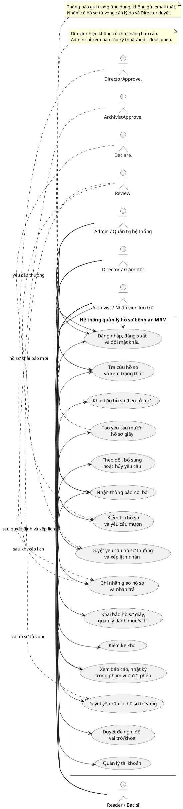

### 5.2. Mã Use Case PlantUML riêng cho từng FR

Mỗi khối dưới đây là một sơ đồ độc lập, có thể sao chép riêng vào PlantUML. NFR tiếp tục được mô tả ở mục 3 vì chúng là ràng buộc chất lượng, không phải Use Case riêng.

#### FR-01 — Đăng nhập và đăng xuất

```plantuml
@startuml
left to right direction
actor "Reader / Bác sĩ" as R
actor "Archivist / Nhân viên lưu trữ" as A
actor "Director / Giám đốc" as D
actor "Admin / Quản trị viên" as X
rectangle "MRM – FR-01" { usecase "Đăng nhập / đăng xuất" as U }
R -> U
A -> U
D -> U
X -> U
@enduml
```

#### FR-02 — Quản lý tài khoản và vai trò

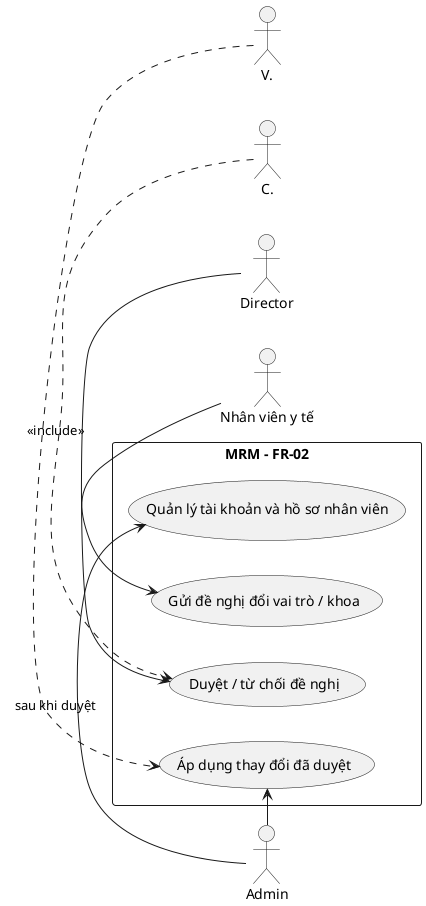

#### FR-03 — Tra cứu HSBA

```plantuml
@startuml
left to right direction
actor "Reader" as R
actor "Archivist" as A
actor "Director" as D
rectangle "MRM – FR-03" { usecase "Tra cứu hồ sơ bệnh án" as U }
R -> U
A -> U
D -> U
@enduml
```

#### FR-04 — Hiển thị thông tin theo vai trò

```plantuml
@startuml
left to right direction
actor "Reader" as R
actor "Archivist" as A
actor "Director" as D
actor "Admin" as X
rectangle "MRM – FR-04" { usecase "Áp dụng quyền xem dữ liệu theo vai trò" as U }
R -> U
A -> U
D -> U
X -> U
note right of U
 Admin không được xem metadata bệnh án.
 Reader không xem vị trí kho chi tiết.
end note
@enduml
```

#### FR-05 — Quản lý vị trí vật lý

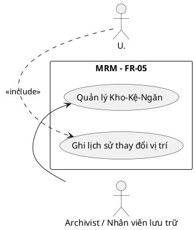

#### FR-06 — Quản lý trạng thái hồ sơ

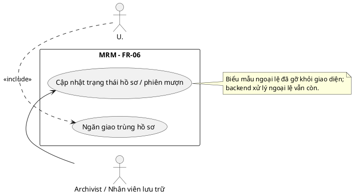

#### FR-07 — Khởi tạo/cập nhật metadata HSBA

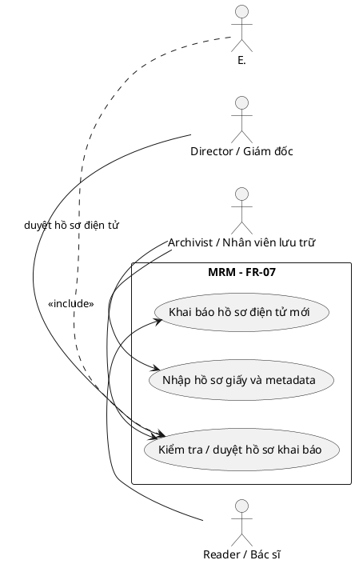

#### FR-08 — Đăng ký mượn hồ sơ

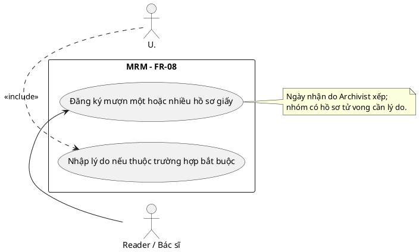

#### FR-09 — Kiểm tra yêu cầu và chuyển luồng duyệt

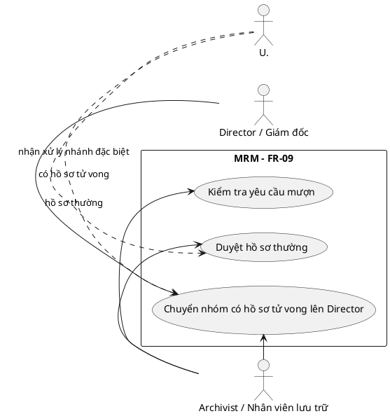

#### FR-10 — Phê duyệt điện tử

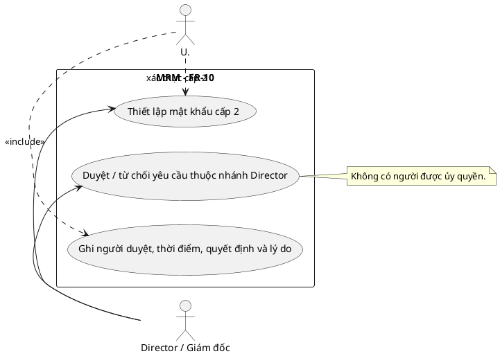

#### FR-11 — Thông báo kết quả và lịch

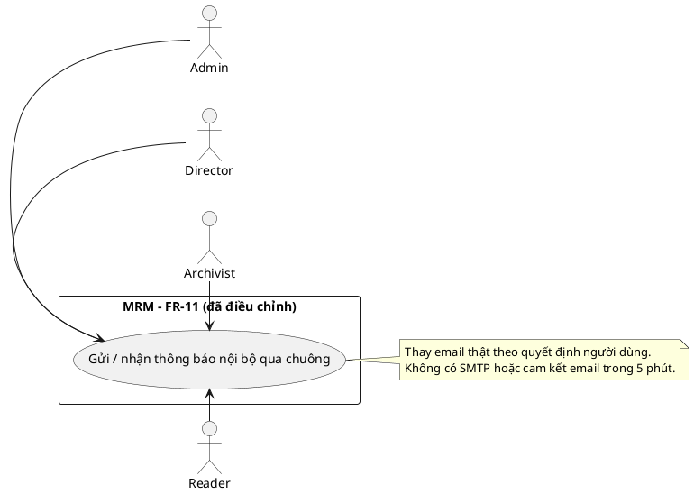

#### FR-12 — Giao nhận và trả HSBA

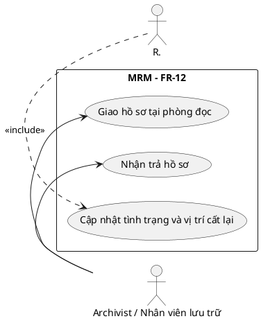

#### FR-13 — Audit trail

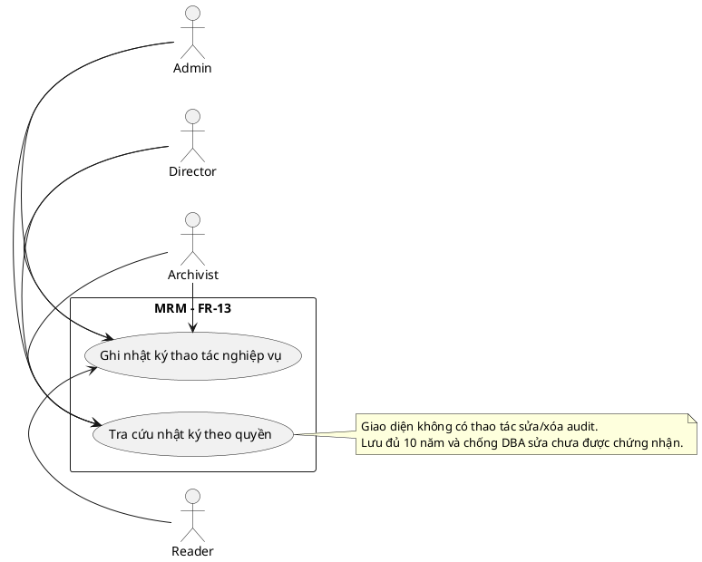

#### FR-14 — Hồ sơ tử vong

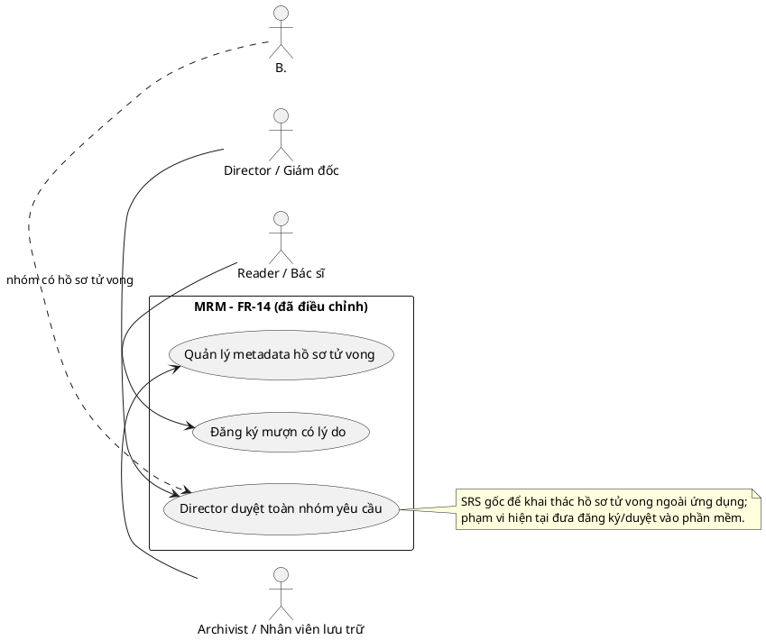

#### FR-15 — Thời hạn lưu trữ

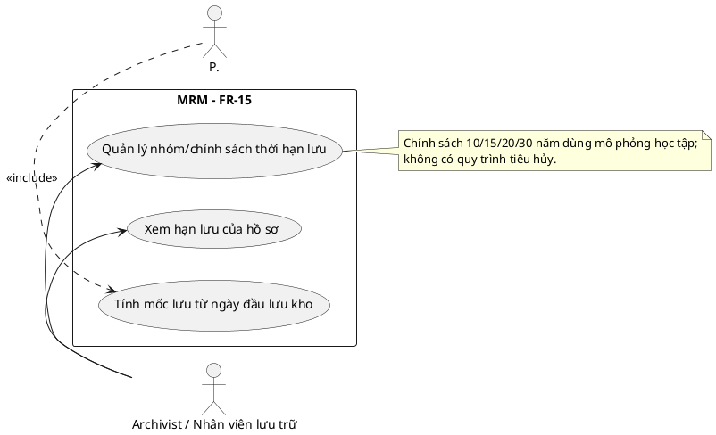

#### FR-16 — Báo cáo và thống kê

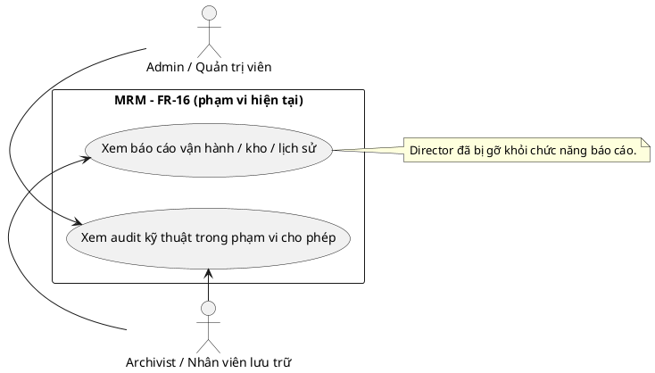

#### FR-17 — Khởi tạo dữ liệu không tích hợp HIS

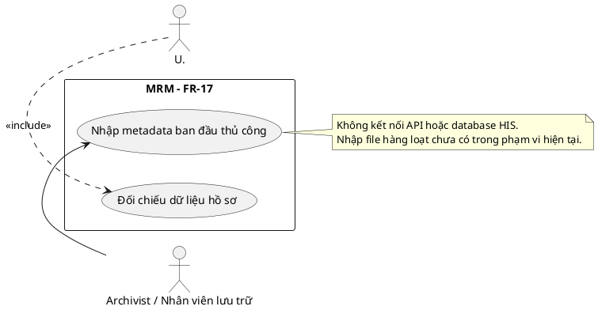

#### FR-18 — Yêu cầu từ cơ quan bên ngoài (ngoài phạm vi)

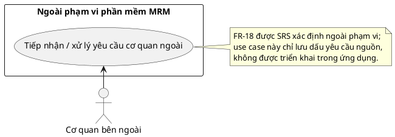

#### FR-19 — Kiểm kê và đối soát kho

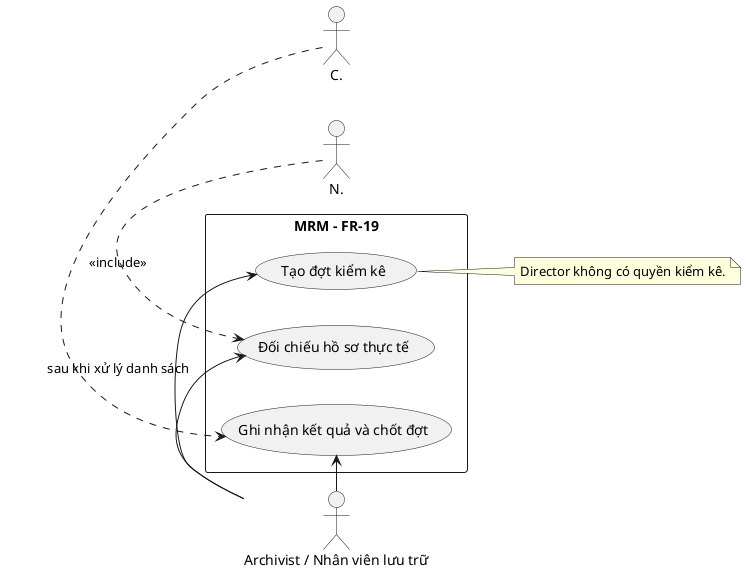

#### FR-20 — Xuất dữ liệu/báo cáo

```plantuml
@startuml
left to right direction
actor "Archivist" as A
actor "Admin" as X
rectangle "MRM – FR-20" {
 usecase "Xuất CSV hoặc in báo cáo" as U
 usecase "Áp dụng quyền và bộ lọc báo cáo" as C
 usecase "Ghi audit thao tác xuất / in" as L
}
A -> U
X -> U: audit được phép
U..> C: <<include>>
U..> L: <<include>>
note right of U
 PDF được tạo qua hộp in trình duyệt;
 ứng dụng không tạo file PDF/XLSX riêng.
end note
@enduml
```

**Lưu ý về FR-18:** SRS phân loại yêu cầu cơ quan bên ngoài là ngoài phạm vi. Khối FR-18 được giữ riêng để bạn truy vết yêu cầu nguồn, không được hiểu là chức năng đã triển khai.

## 6. Hạng mục còn thiếu hoặc cần xác nhận trước khi gọi là hoàn tất

1. Chạy lại kiểm thử chức năng trên **revision mã nguồn hiện tại**; báo cáo kiểm thử cũ ghi nhận chạy vào và không tự chứng minh những thay đổi phát sinh sau đó.
2. Kiểm thử chấp nhận với từng vai trò, đặc biệt nhánh yêu cầu thường/tử vong, hủy, thông báo, giao–trả và đề nghị đổi role/khoa.
3. Đo hiệu năng theo tải mục tiêu; cấu hình triển khai nội bộ, HTTPS, quản lý secret và giám sát.
4. Thiết lập, chạy thử và lưu bằng chứng backup/restore; chốt RPO/RTO, giờ vận hành và quy trình khi mất mạng.
5. Rà soát quyền dữ liệu cá nhân, quy chế lưu trữ, thời hạn và luồng hồ sơ tử vong với đơn vị có thẩm quyền trước khi dùng dữ liệu thật.
6. Quyết định có khôi phục UI xử lý ngoại lệ hay bỏ hẳn chức năng backend; hiện trạng là UI đã gỡ nhưng endpoint còn.
7. Nếu cần đáp ứng SRS nguyên bản, phải xem xét lại SMTP/email, phạm vi báo cáo Director, kiểm kê Director, nhánh ủy quyền và xử lý hồ sơ tử vong ngoài phần mềm.

## 7. Nguồn đối chiếu

- `SRS_Quan_ly_luu_tru_HSBA_v0.2_da_lam_ro.docx` — đường cơ sở FR/NFR.
- `Nhận xét SRS và đặc tả use case – Quản lý lưu trữ HSBA.docx` — nhận xét và đề xuất làm rõ.
- `Danh_gia_SRS_va_Use_Case_HSBA.docx` — đánh giá/đối chiếu UC và đề xuất.
- Mã nguồn hiện tại: `src/main/java/mrm/`, `src/main/resources/templates/`, migrations Java dưới `src/main/java/mrm/database/migration/`.
- Tài liệu dự án: `docs/verification/FR_COMPLETION_REPORT.md`, `docs/requirements/scope.md`, `docs/requirements/decision-log.md`, `docs/requirements/non-functional.md`.

