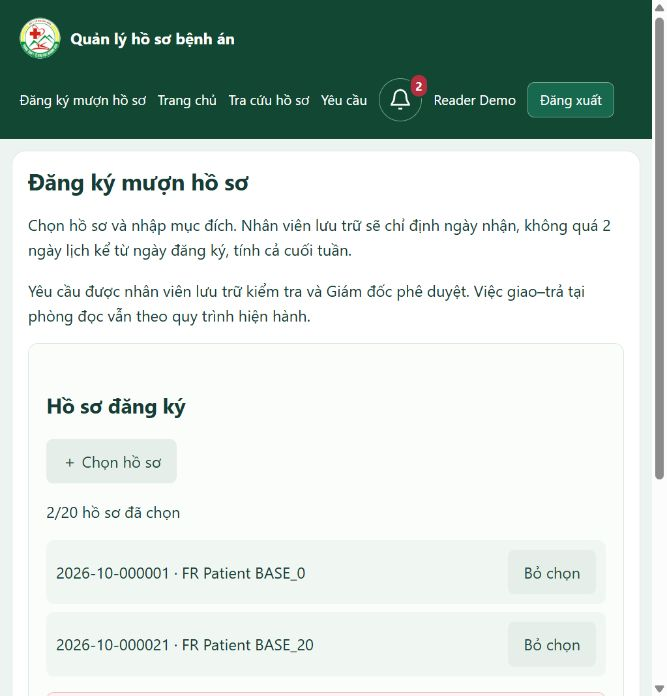
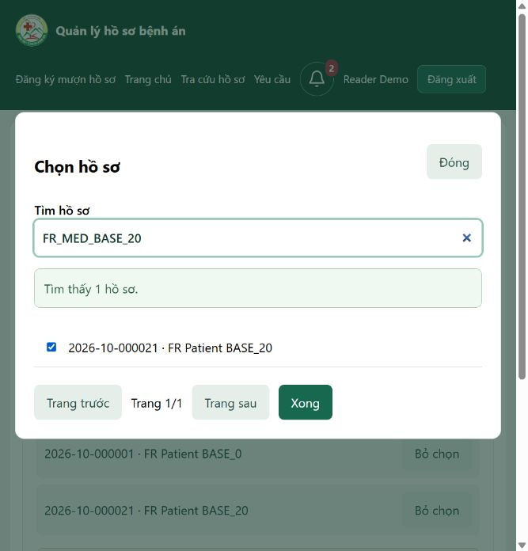

# Đăng ký mượn nhiều hồ sơ và chỉ định ngày nhận

**Bổ sung cùng ngày:** [menu, thông tin mở rộng và kiểm tra hồ sơ còn trống](BORROW_PICKER_AVAILABILITY.md). Bộ chọn hiện ẩn cả hồ sơ có đăng ký chưa hoàn tất, có mở rộng thông tin nhận diện và chặn giữ trùng ở backend; các mô tả bộ chọn trong mốc ban đầu dưới đây cần đọc cùng bản bổ sung này.

Ngày. Phạm vi được xác nhận ở [CR-011](../changes/CR-011_borrowing-batches-and-pickup-window.md).

## 1. Reader sử dụng

1. Mở **Đăng ký mượn hồ sơ** từ menu/trang chủ hoặc `/reader/requests/new`. Bấm số lưu trữ chưa được cấp quyền cũng mở form này với hồ sơ chọn sẵn.
2. Bấm **＋ Chọn hồ sơ** để mở cửa sổ tương tự chọn file đính kèm. Tìm bằng số lưu trữ/số bệnh án/mã người bệnh hoặc tên, đánh dấu hồ sơ; dùng Trang sau/Trang trước nếu cần. Lựa chọn được giữ khi đổi trang hoặc tìm kiếm.
3. Bấm **Xong**. Danh sách đã chọn hiện bên dưới; Bỏ chọn loại một hồ sơ. Mỗi lần gửi từ 1 đến 20 hồ sơ khác nhau.
4. Nhập mục đích và **Gửi đăng ký mượn**. Reader không có ô; backend cũng từ chối POST cố gán dates/pickupOn.
5. Xem kết quả riêng từng hồ sơ tại Yêu cầu. Mỗi yêu cầu có người gửi, ngày đăng ký, hạn nhận, trạng thái, thông báo và lịch sử độc lập. Lưu trữ/Director có thể xử lý từng hồ sơ khác nhau trong cùng lần đăng ký.

Chọn hồ sơ là chọn dữ liệu đã có trong hệ thống; không mở ổ đĩa hoặc tải bản bệnh án lên. Bộ chọn chỉ liệt kê hồ sơ STORED, chất lượng NORMAL, đang IN_STORAGE, không tử vong. API chỉ trả thông tin nhận diện tối thiểu; không có vị trí kho, mã người bệnh, ngày sinh hoặc ghi chú nội bộ. Hồ sơ có thể thay đổi sau lúc chọn; backend kiểm tra lại toàn bộ khi gửi.

## 2. Archivist và Director xử lý

Reader gửi vẫn báo chuông cho Archivist. Archivist kiểm tra/trả bổ sung/trình như trước; trình báo chuông Director. Director duyệt/từ chối bằng mật khẩu cấp 2.

Với yêu cầu mới APPROVED, Archivist mở chi tiết → **Xác nhận lịch** → chọn **Ngày nhận do nhân viên lưu trữ chỉ định**, nhập hướng dẫn/phòng đọc rồi xác nhận. Đây là thời điểm tạo một reading_sessions cho yêu cầu. Trước đó, việc đăng ký/duyệt không tạo ngày nhận giả định.

Ngày nhận được phép nằm từ ngày hiện tại đến hạn nhận (= ngày đăng ký gốc + 2 ngày lịch), không trước ngày đăng ký. Kể cả cuối tuần. Ngoài khoảng này bị chặn ở service; trigger database kiểm tra ngày phiên nằm trong khoảng đăng ký/hạn nhận cho nhánh ARCHIVIST. Không có ngày hợp lệ nếu đã quá hạn: cần hủy/đăng ký mới, không sửa mục đích để gia hạn. Thao tác phê duyệt mới và giao hôm nay cũng kiểm tra hạn nhận.

Xác nhận lịch tạo thông báo cho Reader. Giao chỉ đúng ngày nhận đã xác nhận, hồ sơ phải khả dụng, không trùng lịch cùng hồ sơ/ngày. Giao–trả, ghi chất lượng, nhận trả khác ngày cần ngoại lệ, nhật ký và kiểm kê vẫn dùng nghiệp vụ hiện có. Quy trình này không tự mở chức năng mang bệnh án ra khỏi phòng đọc hoặc mượn nhiều ngày.

## 3. Quyền xem và sửa

Reader vẫn được xem metadata sau Director duyệt. Nếu chưa xếp ngày thì quyền có hiệu lực đến hết hạn nhận; khi đã xác nhận ngày, quyền theo ngày nhận hiện tại như trước. Đúng tài khoản, đúng hồ sơ và phê duyệt còn hiệu lực mới xem được; sửa/hủy làm mất quyền của yêu cầu đó. Một yêu cầu được duyệt còn hiệu lực khác có thể tiếp tục cấp quyền.

Sửa mục đích trước khi từng giao hồ sơ sẽ xóa lịch chưa giao và quyết định, tăng revision, trả SUBMITTED và báo Archivist. Ngày đăng ký không đổi. Sau khi từng giao, không sửa yêu cầu; hủy phần chưa thực hiện hoặc đăng ký mới theo quy tắc cũ.

## 4. Database

| Bảng/cột | Vai trò |
|---|---|
| reading_request_batches | Một lần gửi: id, submit_token chống lặp, requester_id, purpose ban đầu, registered_on và created_at |
| reading_requests.batch_id | Liên kết các yêu cầu từng hồ sơ trong cùng lần gửi; NULL cho lịch sử cũ |
| reading_requests.registered_on | Ngày đăng ký lấy tại server theo Asia/Bangkok, không nhận từ Reader |
| reading_requests.pickup_deadline | Cột sinh tự động registered_on + 2 |
| reading_requests.scheduling_mode | ARCHIVIST cho mới, LEGACY cho dữ liệu trước nâng cấp |
| reading_sessions | Chỉ tạo sau Archivist chỉ định ngày nhận; lịch sử cũ được giữ nguyên |

Đăng ký nhiều hồ sơ dùng một transaction và khóa token; khóa hồ sơ theo thứ tự nhất quán, kiểm tra đủ các hồ sơ trước khi tạo batch. Một hồ sơ không hợp lệ sẽ không lưu một phần. Unique(batch_id,record_id) chống chọn trùng trong một lần. Cùng token, cùng tập hồ sơ/mục đích trả lại đúng các ID cũ, không phụ thuộc thứ tự chọn; khác nội dung bị từ chối. Không xóa batch/yêu cầu cũ khi gửi lại.

Không ghép các yêu cầu lịch sử thành batch giả. LEGACY giữ lịch trước nâng cấp, kể cả ngày ngoài giới hạn mới; không hồi tố đổi thời điểm/hạn lịch cũ. Nếu Reader sửa một yêu cầu cũ thì chuyển sang quy trình ARCHIVIST và không gia hạn ngày đăng ký gốc; có thể phải hủy và đăng ký mới nếu đã hết hạn.

## 5. File chỉnh sửa giao diện

- [reading/new.html](../../src/main/resources/templates/reading/new.html): form đăng ký không ngày, cửa sổ chọn và danh sách hồ sơ đã chọn.
- [borrow-record-picker.js](../../src/main/resources/static/js/borrow-record-picker.js): tìm kiếm, phân trang, giữ/bỏ lựa chọn, giới hạn 20.
- [reading/detail.html](../../src/main/resources/templates/reading/detail.html): Reader chỉ sửa mục đích; Archivist có ô ngày nhận.
- [reading/list.html](../../src/main/resources/templates/reading/list.html): theo dõi từng yêu cầu, ngày nhận/chờ xếp lịch.
- [layout.html](../../src/main/resources/templates/fragments/layout.html), [home.html](../../src/main/resources/templates/home.html): menu/nút Đăng ký mượn hồ sơ.
- [app.css](../../src/main/resources/static/css/app.css): nhóm borrow-picker, borrow-dialog-header, borrow-result, borrow-selections.

reading-dates.html và reading-dates.js của mốc trước không còn được các form Reader sử dụng; giữ file để tham khảo, không phải chức năng hiện tại. Không đổi Note.

## 6. Kiểm chứng

Đã kiểm tra trực tiếp bằng trình duyệt trong schema tạm với tài khoản/dữ liệu giả: mở đăng ký từ menu, mở cửa sổ, chọn hồ sơ trên hai trang, giữ lựa chọn, bỏ một lựa chọn, tìm theo mã chính xác và xác nhận hồ sơ đã chọn vẫn được đánh dấu. Ảnh dưới là dữ liệu giả, không phải bệnh án thật.

Bộ FR mở rộng đã kiểm tra: không tạo ngày khi Reader gửi; nhiều yêu cầu chung batch; replay không trùng và không phụ thuộc thứ tự UUID; rollback toàn bộ khi chọn hồ sơ không hợp lệ; Reader không xếp lịch/không chèn ngày qua HTTP; ngày +2 được nhận, +3/quá hạn/ngày quá khứ bị chặn; trigger chống ngày ngoài hạn; quyền metadata trước/sau xếp lịch; hủy/sửa; API tối thiểu và cấm role khác; các nghiệp vụ xác thực/tài khoản/kho/đọc/chuông/báo cáo còn lại. Kết quả tổng hợp và kiểm kê thực tế được ghi ở phần hoàn tất.

## 7. Hoàn tất và bằng chứng

Build package và kiểm tra cú pháp JavaScript thành công. V14 áp dụng vào `mrm/public` lúc **19:46:47 **. Chạy đầy đủ các bộ danh mục, bootstrap, năm chức năng và FR mới; bổ sung một ca tương thích LEGACY sau lần xem thử. Kết quả cuối **444/444** (49 + 26 + 96 + 273). Đây là số kiểm tra Java chạy trực tiếp, không phải số test JUnit do Maven tự chạy.

| Bộ / kiểm kê | Bằng chứng |
|---|---|
| Danh mục 49/49 | [catalog.txt](evidence/borrowing-batches-2026-10-24/catalog.txt) |
| Bootstrap V1–V14, 26/26 | [bootstrap-and-policy.txt](evidence/borrowing-batches-2026-10-24/bootstrap-and-policy.txt) |
| Năm chức năng 96/96 | [five-features.txt](evidence/borrowing-batches-2026-10-24/five-features.txt) |
| FR 273/273, gồm LEGACY | [functional-requirements.txt](evidence/borrowing-batches-2026-10-24/functional-requirements.txt) |
| Trước nâng cấp | [borrowing-before.txt](evidence/borrowing-batches-2026-10-24/borrowing-before.txt) |
| Sau nâng cấp/kiểm thử | [borrowing-after.txt](evidence/borrowing-batches-2026-10-24/borrowing-after.txt) |
| Kiểm tra lịch sử/hạn nhận | [borrowing-upgrade.txt](evidence/borrowing-batches-2026-10-24/borrowing-upgrade.txt) |

Database thật sau kiểm tra vẫn có 5 tài khoản, 1 hồ sơ nhân viên, 15 bệnh án, 2 yêu cầu LEGACY, 4 phiên và 6 sự kiện yêu cầu; batch mới = 0. Kiểm tra cả hai yêu cầu có registered_on lấy đúng ngày tạo theo Asia/Bangkok và deadline sinh +2. Không đổi trạng thái/ngày của 4 phiên cũ; audit đăng nhập do hồi quy được giữ (96 trước/107 sau), không xóa để làm sạch số đếm.

Các schema tạm chứa dữ liệu thử đã dọn; tab trình duyệt và ứng dụng phụ phục vụ kiểm chứng đã đóng/dừng. Người dùng cần **khởi động lại phiên dev đang chạy và tải lại trang** để dùng controller/template/JavaScript mới; form cũ gửi ngày sẽ bị từ chối với hướng dẫn dùng mẫu mới.
