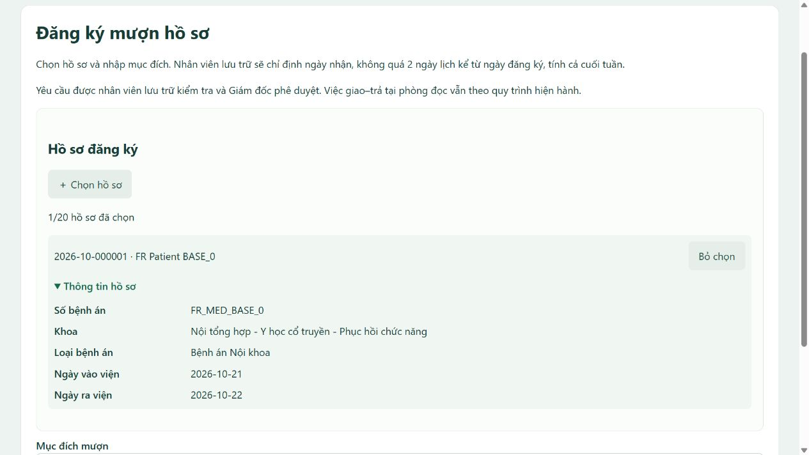

# Menu, thông tin mở rộng và hồ sơ còn trống —

## Giao diện

Menu Reader theo thứ tự **Trang chủ → Tra cứu hồ sơ → Đăng ký mượn hồ sơ → Yêu cầu**; các mục khác giữ quyền như trước.

Ở mỗi hồ sơ đã chọn có dấu mở rộng **Thông tin hồ sơ**. Bấm để xem số bệnh án, khoa, loại bệnh án, ngày vào viện và ngày ra viện. Dùng details/summary để hỗ trợ bàn phím, đóng/mở và giữ trạng thái khi chọn thêm hồ sơ. Không hiện vị trí kho, mã người bệnh, ngày/năm sinh, giới tính, ghi chú nội bộ hoặc lịch sử vận hành ở đây.

Người dùng đã xác nhận giữ quyền duyệt. Đây chỉ là thông tin nhận diện trong bộ chọn, không thay thế trang chi tiết có điều kiện phê duyệt. Endpoint mở rộng `/reader/requests/records/{id}` kiểm tra Reader ACTIVE và hồ sơ còn khả dụng; các trường trả về được giới hạn bằng DTO riêng.

## Quy tắc còn trống

Chỉ hiển thị hồ sơ STORED, NORMAL, IN_STORAGE, không tử vong và không bị giữ bởi đăng ký đang hoạt động của bất kỳ Reader nào:

| Trạng thái yêu cầu/phiên | Có giữ hồ sơ khỏi bộ chọn? |
|---|---|
| SUBMITTED / NEEDS_INFO / PENDING_APPROVAL / APPROVED | Có |
| CONFIRMED còn phiên REQUESTED / CONFIRMED / READING | Có |
| CONFIRMED nhưng không có phiên (dữ liệu không nhất quán) | Có, cần đối soát |
| CANCELLED / REJECTED | Không |
| CONFIRMED với tất cả phiên đã RETURNED / CANCELLED / NO_SHOW | Không, nếu trạng thái/chất lượng hồ sơ vẫn đủ điều kiện |

Hồ sơ đang giao đọc bị loại bởi cả physical_status và phiên chưa kết thúc. Hồ sơ trả hỏng/thiếu vẫn không xuất hiện. Đăng ký quá hạn nhưng chưa được hủy/từ chối vẫn giữ chỗ; không âm thầm đổi trạng thái hoặc xóa lịch sử. Khi đã có nhiều đăng ký cũ cho cùng hồ sơ, tất cả đăng ký giữ chỗ phải kết thúc mới xuất hiện lại.

`BorrowAvailability.NO_ACTIVE_REQUEST` là điều kiện SQL dùng chung cho danh sách, preview và kiểm tra gửi. Khi submitBatch, service khóa từng medical_records theo thứ tự thống nhất rồi kiểm tra giữ chỗ; khóa giữ đến commit. Hai người cùng nhìn thấy hồ sơ còn trống trước đó không thể cùng gửi thành công. Một hồ sơ vừa bị người khác đăng ký sẽ làm cả batch không được lưu dở. Replay cùng token/nội dung vẫn trả phiếu cũ, không tạo mới.

Nếu bấm từ tra cứu vào một hồ sơ đang bị giữ chỗ, form không chọn sẵn hồ sơ đó và báo chọn hồ sơ khác. Khi gửi gặp lỗi do hồ sơ không còn trống, các mục không khả dụng không được đưa lại vào danh sách chọn sẵn. Thông tin nhận diện trong mở rộng cũng kiểm tra lại khi tải.

Không thay schema V14 hoặc chỉnh dữ liệu thật; chỉ thay giao diện và quy tắc chọn/đăng ký mới. Không tự hủy yêu cầu đã tồn tại.

## File chỉnh sửa

- [layout.html](../../src/main/resources/templates/fragments/layout.html): vị trí menu.
- [reading/new.html](../../src/main/resources/templates/reading/new.html): thẻ mở rộng và markup chọn hồ sơ.
- [borrow-record-picker.js](../../src/main/resources/static/js/borrow-record-picker.js): dựng/mở thông tin, giữ lựa chọn và trạng thái mở.
- [app.css](../../src/main/resources/static/css/app.css): nhóm borrow-record-details; ẩn vùng lỗi rỗng.
- [BorrowAvailability.java](../../src/main/java/mrm/record/BorrowAvailability.java), [RecordService.java](../../src/main/java/mrm/record/RecordService.java), [ReadingService.java](../../src/main/java/mrm/workflow/ReadingService.java): điều kiện còn trống và khóa khi gửi.

## Kiểm chứng

Build package và kiểm tra cú pháp JS thành công. FunctionalRequirementsCheck đạt **289/289** trong schema tạm đã dọn; lần này không cộng kết quả các bộ khác từ lần trước. Các kiểm tra gồm các trạng thái giữ chỗ, mở lại sau hủy/từ chối/trả đầy đủ, giữ yêu cầu quá hạn chưa đóng, API không lộ trường cần duyệt, menu, markup mở rộng và hai Reader đăng ký cùng lúc chỉ một thành công.

Đã kiểm tra trực tiếp trên trình duyệt với dữ liệu giả: menu theo thứ tự mới; mở bộ chọn, chọn một hồ sơ, mở Thông tin hồ sơ và thấy đủ năm trường nhận diện. Tab và ứng dụng kiểm thử đã đóng, không gửi đăng ký thử vào database thật. Trích kết quả hoàn tất tại [completion.txt](evidence/borrow-picker-2026-10-24/completion.txt).

Khởi động lại ứng dụng và tải lại trang để nhận Java/template/JavaScript mới. Quy tắc Director duyệt và hạn nhận 2 ngày vẫn áp dụng như [CR-011](../changes/CR-011_borrowing-batches-and-pickup-window.md).
