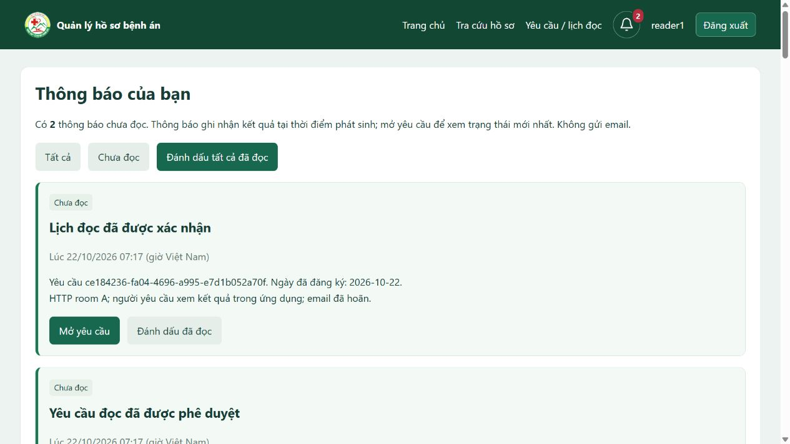

# Báo cáo FR-11 — Thông báo nội bộ và chuông thông báo

Ngày, Asia/Bangkok. Phạm vi được người dùng xác nhận tại [CR-007](../changes/CR-007_internal-notifications.md). Báo cáo bổ sung cho [báo cáo FR ngày 21/10](FR_COMPLETION_REPORT.md); email vẫn hoãn.

## Mục đích và hành vi

Reader nhận thông báo khi yêu cầu đọc của mình được trả bổ sung, Director phê duyệt/từ chối, Archivist xác nhận lịch hoặc khi hủy yêu cầu/ngày đọc chưa thực hiện. Mỗi sự kiện tạo một thông báo; đăng ký hay trình duyệt đơn thuần không tạo thông báo kết quả.

Chuông ở thanh đầu trang đã đăng nhập hiển thị số chưa đọc; trên 99 hiển thị `99+`. Bấm chuông mở `/notifications`: có bộ lọc Tất cả/Chưa đọc, phân trang 20 thông báo, đánh dấu một hoặc tất cả đã đọc, và mở yêu cầu liên quan. Nội dung gồm mã yêu cầu, các ngày đăng ký và chi tiết kết quả; không thêm tên bệnh nhân hoặc vị trí kho chi tiết.

Thông báo là bản ghi sự kiện lịch sử. Một yêu cầu có thể có cả thông báo phê duyệt cũ và thông báo hủy mới. Danh sách ngày là các ngày đăng ký của yêu cầu; quyết định xác nhận thể hiện trong nội dung và lịch hiện tại. Đánh dấu đã đọc chỉ ghi nhận đã xem thông báo, không đồng nghĩa chấp thuận, giao hoặc trả bệnh án.

## Nguyên lý Java, HTML và database

1. Thao tác nghiệp vụ trong `ReadingService` ghi sự kiện yêu cầu và gọi `NotificationService.forRequest` trong cùng transaction. Lỗi ở bất kỳ phần nào làm rollback cả kết quả, sự kiện và thông báo.
2. Service lấy người nhận từ `reading_requests.requester_id`, không nhận người nhận tùy ý từ trình duyệt. Khóa duy nhất `(recipient_id,event_id)` ngăn lặp cùng sự kiện.
3. `WebModelAdvice` cung cấp số chưa đọc; Thymeleaf render biểu tượng chuông và badge trong fragment dùng chung. Các trang danh mục cũ cũng dùng header này.
4. `NotificationController` lấy danh sách theo người đăng nhập. Các POST đánh dấu/mở yêu cầu cần CSRF; đường dẫn yêu cầu đích được lấy từ database. Đoán UUID của người khác trả 404.
5. Chỉ tài khoản ACTIVE có role READER được đọc thông báo nghiệp vụ của mình. Các role khác có chuông và hộp rỗng; đổi Reader thành Admin không giữ quyền đọc thông báo cũ.
6. Trạng thái đã đọc lưu trong PostgreSQL, không mất khi đăng xuất hoặc khởi động lại. Đánh dấu lặp không đổi thời điểm cũ; audit chỉ ghi khi thực sự cập nhật. Dùng thời gian thực tại thao tác cập nhật để xử lý thông báo đến trong lúc transaction đánh dấu tất cả đang chạy.

Không cần SMTP, tiến trình gửi thư hoặc thư viện frontend mới. Số chuông cập nhật khi tải/chuyển trang; muốn thấy thay đổi khi đang đứng yên, tải lại trang. Không có polling/WebSocket, không cam kết email trong 5 phút và không tạo bù thông báo cho sự kiện cũ.

## Thay đổi database

Flyway Java `V9__CreateInternalNotifications` đã áp dụng thành công vào `mrm/public`**07:19:51 **. Thêm bảng `notifications`, khóa ngoại tới tài khoản/yêu cầu/sự kiện, chỉ mục hộp thư/chưa đọc và ràng buộc thời gian đọc. Không thay mật khẩu, vai trò, khoa hay dữ liệu hồ sơ hiện có. Không sửa V1–V9 đã áp dụng; thay đổi schema tiếp theo dùng V10 trở lên.

| Cột | Ý nghĩa |
|---|---|
| id | UUID của thông báo |
| recipient_id | Tài khoản nhận |
| request_id / event_id | Yêu cầu và sự kiện tạo thông báo |
| title / message | Nội dung tại thời điểm phát sinh |
| created_at | Thời điểm tạo |
| read_at | NULL khi chưa đọc; thời điểm đánh dấu đã đọc |

## Hướng dẫn kiểm thử thủ công trên web

1. Đăng nhập Reader, tìm hồ sơ đủ điều kiện và đăng ký ngày đọc. Ghi lại mã yêu cầu.
2. Ở trình duyệt/phiên đăng nhập khác, Archivist trả yêu cầu bổ sung. Reader tải lại trang: chuông tăng 1; mở chuông thấy đúng yêu cầu và lý do.
3. Bấm Mở yêu cầu: chuyển đúng yêu cầu của Reader và thông báo được đánh dấu đã đọc. Bổ sung lại, Archivist trình, Director duyệt bằng mật khẩu cấp 2: Reader nhận thông báo kết quả.
4. Archivist xác nhận lịch: Reader nhận thêm thông báo lịch. Thử một yêu cầu khác bị từ chối và một yêu cầu được hủy để kiểm tra các kết quả còn lại.
5. Dùng Chưa đọc, Đánh dấu đã đọc và Đánh dấu tất cả đã đọc; đối chiếu badge sau tải lại. Không cần xóa thông báo để đưa số về 0.
6. Đăng nhập Reader khác: không thấy thông báo của tài khoản đầu. Admin/Director/Archivist không có hộp thông báo bệnh án của Reader.

Tạo hồ sơ/yêu cầu thử riêng, tránh hủy dữ liệu nghiệp vụ thật. Những bước trên là kịch bản nghiệm thu để người dùng tự thực hiện, không phải xác nhận người dùng đã nghiệm thu.

## Kiểm chứng kỹ thuật

Build offline thành công. Bộ kiểm tra chạy bằng `scripts/verify-features.ps1`, gọi các chương trình kiểm tra Java trực tiếp; số đếm không phải số test JUnit/Surefire.

Kết quả chạy –07:22 ngày: **341/341 kiểm tra đạt**.

| Bộ kiểm tra | Kết quả | Log |
|---|---|---|
| Danh mục qua service và HTTP | 49/49 | [catalog.txt](evidence/fr11-2026-10-22/catalog.txt) |
| Bootstrap/schema mới và chính sách | 26/26 | [bootstrap-and-policy.txt](evidence/fr11-2026-10-22/bootstrap-and-policy.txt) |
| Năm chức năng nền tảng | 96/96 | [five-features.txt](evidence/fr11-2026-10-22/five-features.txt) |
| FR mở rộng, gồm thông báo | 170/170 | [functional-requirements.txt](evidence/fr11-2026-10-22/functional-requirements.txt) |

Bộ mở rộng kiểm tra recipient, số chưa đọc, idempotency, rollback kết quả/sự kiện/thông báo, chống trùng, quyền sau đổi role, phân trang, thông báo đến đồng thời với đánh dấu tất cả; HTTP kiểm tra đăng nhập, CSRF, 404 khi đọc/mở của người khác, HTML escape và chuông trên các trang danh mục. Các schema thử đã được dọn; [kiểm kê sau kiểm thử](evidence/fr11-2026-10-22/inventory-after.txt) xác nhận public có V9, bốn tài khoản, năm khoa và không còn hồ sơ/yêu cầu/thông báo thử. Audit xác thực do kiểm tra được giữ lại (27 bản ghi sau thử, 16 trước thử); không xóa log để làm sạch số đếm.

Đã xem trực tiếp bằng trình duyệt với tài khoản và dữ liệu giả: chuông có badge 2, hộp thư hiển thị kết quả phê duyệt/xác nhận và các nút thao tác. Ảnh dưới không phải dữ liệu bệnh nhân thật.

